<p align="center">
  
</p>

# gity

One git, many GitHub/GitLab accounts, zero `~/.ssh/config` surgery.

`gity` wraps git and routes every command through the right SSH key. Type your normal git commands and flags; gity picks the key, sets the commit identity, and remembers which profile owns which repo.

```console
$ gity clone git@github.com:acme/website.git
gity: auto-detect: probing 3 key(s) against git@github.com:acme/website.git ...
gity: auto-detect: key for profile 'work' has access to this repo
Cloning into 'website'...
gity: clone used auto-detected 'work' — ssh key: /home/you/.gity/keys/work_key (rc=0)
gity: '/home/you/website' bound to profile 'work'
```

## Contents

- [Why](#why)
- [Install](#install)
- [Quick start](#quick-start)
- [How it works](#how-it-works)
- [Command reference](#command-reference)
- [Moving between machines](#moving-between-machines)
- [Build it yourself](#build-it-yourself)
- [Security notes](#security-notes)
- [License](#license)

## Why

Multi-account git is usually solved with `~/.ssh/config` host aliases and remembering to type `git@github.com-personal:` URLs. gity replaces that with named profiles, per-repo bindings, and auto-detection — and everything still behaves like plain git.

## Install

You need Python 3.9 or newer, `git`, and OpenSSH (`ssh`, `ssh-keygen` — bundled with Git for Windows).

```bash
# recommended: an isolated install that puts `gity` on your PATH
pipx install git+https://github.com/davids1424/gity.git

# or with plain pip
pip install git+https://github.com/davids1424/gity.git
```

Check it worked:

```bash
gity --version
```

To install from a local checkout instead, see [Build it yourself](#build-it-yourself).

## Quick start

```bash
# 1. create a profile — asks for a commit name, email and key comment,
#    generates an SSH key, and prints the public key
gity profile -i personal

# 2. add the printed public key to your git host
#    (GitHub: Settings → SSH and GPG keys → New SSH key)

# 3. turn on auto-detect and clone; gity finds the profile that can read the repo
gity profile --setauto on
gity clone git@github.com:you/website.git

# ...or name the profile yourself
gity clone git@github.com:you/website.git -p personal
```

From then on, work inside the repo exactly as you would with git:

```bash
cd website
gity pull
gity commit -am "fix"
gity push
```

## How it works

### Profiles

A profile is a name, an SSH keypair, and a commit identity (name + email).

Keys live in `~/.gity/keys/`; profile metadata and repo bindings live in `~/.gity/config.json`. Your real `~/.ssh` directory is never modified.

Profile names may contain letters, digits, `.`, `_` and `-`.

### Which key is used

For any git command the profile is chosen in this order:

1. `--profile NAME` on the command line (one-shot, anywhere in the line)
2. the profile bound to the current repo
3. the default profile (`gity profile -d NAME`)

If none applies, gity steps aside and git runs with your normal SSH setup.

`gity clone` also accepts the short form `-p NAME`. Other commands don't, because `-p` already means something to git (`git log -p`, `git add -p`, …) — use `--profile` there.

### Auto-detect (multi-account clones)

This is the part that solves the classic "wrong account" problem. With `--setauto on`, an SSH clone with no explicit profile probes every profile key — and crucially, it checks **access to the actual repo**, not just host authentication.

Host auth alone is a trap: `ssh -T git@github.com` succeeds with *any* registered key, so a key for account A can pass while the repo lives under account B — and git reports a misleading `Repository not found`. gity therefore runs a second check (`git ls-remote` against the target URL) and only binds a profile whose key can actually read the repo. If none can, it says so and falls back to the normal resolution order instead of guessing.

Two things to know:

- Auto-detect applies to SSH remotes (`git@host:owner/repo.git`, `ssh://…`). `https://` remotes don't use SSH keys, so they follow the normal resolution order.
- A **public** repo is readable by every account, so the first profile whose key authenticates wins. Pass `-p NAME` when cloning a public repo you intend to push to from a specific account.

### Repo bindings

After a successful clone (or `gity profile -a NAME`), the directory is recorded in `config.json`. Every later `gity pull`, `push`, `fetch`, … inside that directory uses the bound key automatically, and the repo's `user.name` / `user.email` are set from the profile — no per-repo `git config` fiddling.

`gity init` and `gity worktree add` bind the new directory to whichever profile was in effect when you ran them.

### Password-protected profiles (keeping agents out)

Running AI agents or scripts under their own profile is a good way to keep their commits under a separate identity. The catch: any process running as you can read an unprotected key in `~/.gity/keys/` and push as that account. Put a password on the profiles you want to keep for yourself:

```bash
gity profile --setpassword          # pick the profile from a list
gity profile --setpassword personal # or name it
```

gity shows a warning, then hands you to `ssh-keygen`, which encrypts the private key file with your password. The password goes straight into `ssh-keygen` on your terminal and never passes through gity, the command line or the environment. Run the same command again to change the password; leaving the new one empty removes it.

From then on:

- Anything that talks to the remote with that profile (`push`, `pull`, `fetch`, `clone`, …) asks for the password. Local commands like `status`, `commit` and `log` never ask.
- Once you type it, the key stays unlocked for **60 seconds in that terminal only**, so `gity pull && gity push` asks once. `GITY_UNLOCK_SECONDS` changes the window; `gity profile --lock` forgets it straight away.
- The unlocked key lives only in a private, self-expiring `ssh-agent` that belongs to your terminal session. It never goes into your normal ssh-agent or the macOS Keychain, and gity never writes it to disk decrypted.
- A process with no terminal, such as an agent's shell, gets no prompt and no unlocked key, so the command fails with a clear message.
- Auto-detect skips protected profiles, because it can't stop to ask for their passwords. Clone with `-p NAME` to use one.
- `gity profile -l` shows which profiles have a password. Exports keep these keys encrypted with that password.

Lose the password and the key can't be recovered. Create a new profile and register its public key instead.

### Everything else is just git

```bash
gity status -sb
gity log -p -3
gity rebase -i HEAD~3
gity -C ../other-repo fetch --all
```

All commands and flags pass straight through, with `GIT_SSH_COMMAND` pointing at the profile key. Exit codes, colors, paging and editors behave as they do in git.

One deliberate difference: when a profile key is in use, SSH runs non-interactively. Unknown host keys are accepted on first contact (changed host keys are still refused), and SSH never stops to ask a question.

## Command reference

| Command | What it does |
| --- | --- |
| `gity profile -i [NAME]` | Create a profile interactively (new SSH key + commit identity) |
| `gity profile -i NAME --name "Ada Lovelace" --email ada@example.com` | Create a profile without prompts |
| `gity profile -l` | List profiles, repo bindings and the auto-detect setting |
| `gity profile -a NAME` | Bind the repo you're standing in to a profile and set its commit identity |
| `gity profile -d NAME` | Set the default profile |
| `gity profile --setauto [on\|off]` | Turn auto-detect on or off (no value toggles it) |
| `gity profile --setpassword [NAME]` | Encrypt a profile's SSH key with a password (asks which profile when `NAME` is omitted). Run again to change it |
| `gity profile --lock` | Lock every unlocked password-protected key immediately |
| `gity profile --remove NAME` | Delete a profile and its keys, after confirmation (`-y` skips the prompt) |
| `gity profile --delete NAME` | Delete a profile and its keys without asking |
| `gity --export FILE` | Write an encrypted backup of all profiles and keys |
| `gity --import FILE` | Restore a backup |
| `gity --version` | Show the gity and git versions |
| `gity <anything else>` | Runs `git <anything else>` with the right key |

Options for `gity profile -i`:

| Option | Meaning |
| --- | --- |
| `--name`, `--email` | Commit identity. Giving both skips every prompt |
| `--comment` | SSH key comment (defaults to the email) |
| `--type ed25519\|rsa\|ecdsa` | Key type (default `ed25519`) |
| `--bits N` | Key size for RSA keys (default 4096) |

Environment:

| Variable | Meaning |
| --- | --- |
| `GITY_HOME` | Where profiles and keys are stored (default `~/.gity`) |
| `GITY_UNLOCK_SECONDS` | How long a password-protected key stays unlocked in a terminal (default `60`, max `3600`) |

## Moving between machines

Export once, import anywhere. The export file holds your profiles, settings and private keys, encrypted with a passphrase (AES-256-GCM, key derived with PBKDF2-HMAC-SHA256, 600,000 iterations).

```bash
gity --export my-keys.gity      # written with 0600 permissions; ".gity" is added if you omit an extension
gity --import my-keys.gity      # on the new machine
```

Importing merges: profiles you already have are kept as they are. Key paths are rewritten for the importing machine, so an export made under `/Users/alice` imports cleanly under `/home/bob` or `C:\Users\bob`. Repo bindings are machine-local and are never exported.

Lose the passphrase and the export is unrecoverable — there is no reset.

## Build it yourself

Everything below runs from a checkout of this repository.

```bash
git clone https://github.com/davids1424/gity.git
cd gity

# create an isolated environment
python3 -m venv .venv
source .venv/bin/activate            # Windows: .venv\Scripts\activate
python -m pip install --upgrade pip  # editable installs need pip 21.3 or newer
```

**Run from source** — an editable install, so changes to the code take effect immediately:

```bash
pip install -e ".[test]"
gity --version
```

**Run the tests** — they need `git` and `ssh-keygen` on your PATH, never touch your real `~/.gity`, and make no network connections:

```bash
python -m pytest
```

**Build distributable packages** — a wheel and a source archive land in `dist/`:

```bash
pip install build
python -m build
```

**Install the wheel you just built** — anywhere, no checkout needed:

```bash
pip install dist/gity-*.whl          # or: pipx install dist/gity-*.whl
```

Project layout:

```
gity/
  cli.py        argument routing, `gity profile`, clone auto-detect, export/import commands
  profiles.py   profile storage, repo bindings, export/import payloads
  ssh_env.py    runs git with GIT_SSH_COMMAND bound to a profile key
  ssh_helper.py GIT_SSH_COMMAND for password-protected keys
  unlock.py     per-terminal, self-expiring unlock cache for protected keys
  crypto.py     passphrase encryption for export files
  util.py       git URL parsing
tests/
  test_gity.py  test suite
```

## Security notes

- Profile keys are generated **without a passphrase** so git can use them unattended. They are protected by file permissions (`0600`, inside `~/.gity/keys/`), so treat that directory like `~/.ssh`. Use `gity profile --setpassword` on any profile that other processes running as you, such as AI agents, shouldn't be able to use.
- A password-protected key is encrypted at rest. That stops other processes from using it just by reading the file. It does **not** stop malicious code running as your own OS user, which could capture the password as you type it or connect to the unlock agent during its 60-second window. For strict separation, run agents as a different OS user.
- `*.gity` export files contain your private keys. They are encrypted, but only as strong as the passphrase you choose. Don't commit them — the bundled `.gitignore` excludes them.
- Import only export files you trust. gity validates what it unpacks and writes only key files into its own keys directory, but an import still adds SSH identities to your machine.
- Deleting a profile removes only key files inside gity's keys directory.

Found a security problem? Please open an issue at <https://github.com/davids1424/gity/issues> (leave out exploit details and ask for a private channel if it's sensitive).

## License

gity is released under the [MIT License](LICENSE).

gity does not contain or link against any Git source code; it runs the `git` program you already have installed. Git itself is licensed under the GNU General Public License version 2. gity depends on [`cryptography`](https://github.com/pyca/cryptography) (Apache-2.0 / BSD-3-Clause).

gity is an independent project. It is not affiliated with, sponsored by, or endorsed by the Git project or Software Freedom Conservancy. "Git" and the Git logo are trademarks of Software Freedom Conservancy, Inc.
